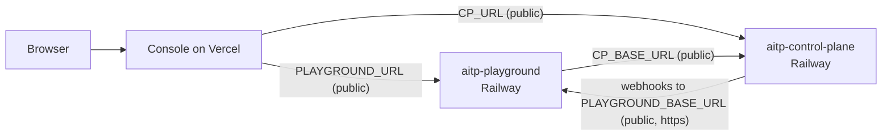

# Railway public domains: impact of removing them

> **Contributor doc, repo only.** A read-only analysis written 2026-11-08 for the
> aitp-hardening rollout (step 6). **Nothing here has been changed.** Removing a
> public domain needs the owner's explicit OK.
>
> Out of scope, never changed: **interop-peer** and **aitp-docs-mcp**. The owner
> decided both are public products and keep their domains.

The console runs on Vercel and reaches its two upstreams over the public
internet. This doc answers one question for each upstream: what breaks if its
public Railway domain is removed?

Vercel is not on Railway's private network, so it can't resolve
`*.railway.internal`. Every arrow from the console has to use a public hostname.

## Recorded configuration

Both services are in the Railway project's `production` environment. Neither
has a custom domain or DNS record. Each has one Railway service domain:

| Service            | Service domain                              | Target port | Private domain                        | Created    |
| ------------------ | ------------------------------------------- | ----------- | ------------------------------------- | ---------- |
| aitp-playground    | Railway service domain (`*.up.railway.app`) | 8000        | `aitp-playground.railway.internal`    | 2026-06-19 |
| aitp-control-plane | Railway service domain (`*.up.railway.app`) | 4000        | `aitp-control-plane.railway.internal` | 2026-06-19 |

Both services bind IPv4 `0.0.0.0`. The Railway project, environment, service
and domain IDs, and the exact hostnames, are recorded in the hardening board
report. They are not kept in this public repo: the console strips upstream
origins from its own error bodies for the same reason.

## Who resolves each hostname

| Config (Doppler `prd`, mirrored to Railway/Vercel) | Value points at   | Used for                                                            |
| -------------------------------------------------- | ----------------- | ------------------------------------------------------------------- |
| aitp-ui-console `PLAYGROUND_URL`                   | playground public | every `/api/playground/*` call (runs, SSE, listings, hosted agents) |
| aitp-ui-console `CP_URL`                           | CP public         | every `/api/cp/*` call, reads and admin writes                      |
| aitp-playground `CP_BASE_URL`                      | CP public         | playground → CP (enroll, events, revocations, webhooks setup)       |
| aitp-playground `PLAYGROUND_BASE_URL`              | playground public | the URL the CP delivers run webhooks to                             |
| aitp-control-plane `CP_BASE_URL`                   | CP public         | the CP's own manifest `handshake_endpoint` and well-known URL       |

**No dependency:** interop-peer (it references only its own hostname),
aitp-docs-mcp, the website, the docs, the spec, and every repo's CI. CI uses
localhost or `*.invalid`. Hosted agents advertise localhost because
`PUBLIC_HOST` is unset, so no external did:web peer uses the playground's
domain.

## Traffic, 2026-11-01 to 2026-11-08 (Railway edge httpLogs; retention is short and has gaps)

- **Playground (332 requests):**
  - The console (Vercel egress).
  - The owner's own scripts.
  - 237 self-calls to `POST /internal/telemetry` from older deployments. That
    bug is fixed in aitp-playground #130: the internal URL now defaults to
    loopback.
- **Control plane (272 requests):**
  - The owner's scripts: registry reads and enroll.
  - The playground over Railway egress: revocations, events, webhooks, enroll.
  - The console: dashboard, audit, sessions, trust anchors.

## What breaks

### aitp-control-plane: **keep**

1. **The whole console CP surface.** Reads could be proxied through the
   playground's `/cp-proxy`, but that route is GET-only
   (`aitp-playground/src/aitp_playground/api/cp_proxy.py:167`). Admin writes
   would have no path: enroll, webhooks, revocations, trust anchors, pinned
   keys.
2. **Playground → CP**, until the playground's `CP_BASE_URL` moves to
   `http://aitp-control-plane.railway.internal:4000`. The CP client doesn't
   require https (`aitp-playground/.../cp_client/client.py`).
3. **The CP's published identity.** Its manifest's `handshake_endpoint` and
   well-known URL come from `CP_BASE_URL`
   (`aitp-control-plane/src/lib/identity/cp-agent.ts:36-39`). The CP only
   warns at boot on a non-public or non-https value
   (`cp-seed-config.ts:108-135`), but the manifest schema requires https, so
   peers that validate it would reject the manifest.

**Remove only after all three hold:**

- The console has a write-capable route to the CP.
- The playground uses the private URL.
- The CP identity has moved to an origin it still serves.

### aitp-playground: **keep**

1. **The whole console playground surface:** runs, SSE, listings, hosted
   agents.
2. **CP → playground webhooks.** The CP's URL guard requires https in
   production and rejects private addresses both when a webhook is created and
   on every delivery
   (`aitp-control-plane/src/lib/webhooks/url-guard.ts:52,87-91,116`). So
   `http://aitp-playground.railway.internal:8000` is refused, and the
   `webhook-subscription` scenario would fail.

**Remove only if** the console moves onto Railway or behind another way in,
**and** the CP webhook guard gets an explicit allowlist for internal targets.

## What already protects these domains

The rollout steps protect both domains without removing them:

- **Playground:** `AITP_PLAYGROUND_REQUIRE_API_KEY=true` since 2026-11-08.
  Every path needs `x-api-key` except these:
  - `/healthz`
  - HMAC-signed `POST /webhooks/cp/{run_id}`
  - loopback `/internal/*`
  - `OPTIONS`

  Verified: keyless `/agents`, `/runs`, `/scenarios` and `/metrics` all return
  401, and console launches still work.

- **Control plane:** it already needs an API key. The console uses the
  read-only key for anonymous reads, and that key gets `403 READ_ONLY_KEY` on
  admin routes.

## Remaining exposure

These are already public by design or relayed from upstream, and removing a
domain doesn't change them:

- The console strips the upstream origin from the 502/504 bodies it builds
  itself (`target` is path + query only, see [PROXIES](../docs/PROXIES.md)).
- Upstream bodies are relayed as-is. Playground run events can carry
  `error=str(exc)`, which may include a URL. AITP manifests carry
  `handshake_endpoint` and did:web hosts by protocol design.

## Re-adding a removed domain

1. Create the domain: `serviceDomainCreate(input: {serviceId, environmentId, targetPort})`,
   with port 8000 for the playground or 4000 for the CP.
2. Claim the old name:
   `serviceDomainUpdate(input: {serviceDomainId, serviceId, environmentId, domain: "<old hostname>", targetPort})`.
3. Railway may not let you reclaim a released `*.up.railway.app` name. If it
   doesn't, update these in Doppler and run each repo's `deploy/doppler-sync.sh --apply`:
   - console `PLAYGROUND_URL`, `CP_URL`
   - playground `CP_BASE_URL`, `PLAYGROUND_BASE_URL`
   - CP `CP_BASE_URL`

   Also rewrite any CP webhook subscriptions stored with the old URL.

There is no DNS or custom-domain record to recreate.
